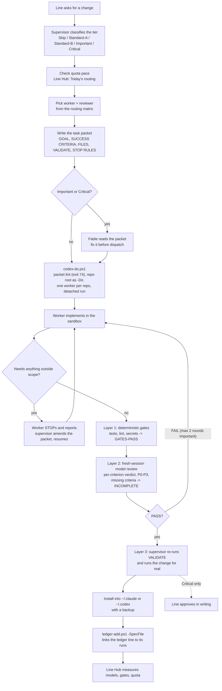
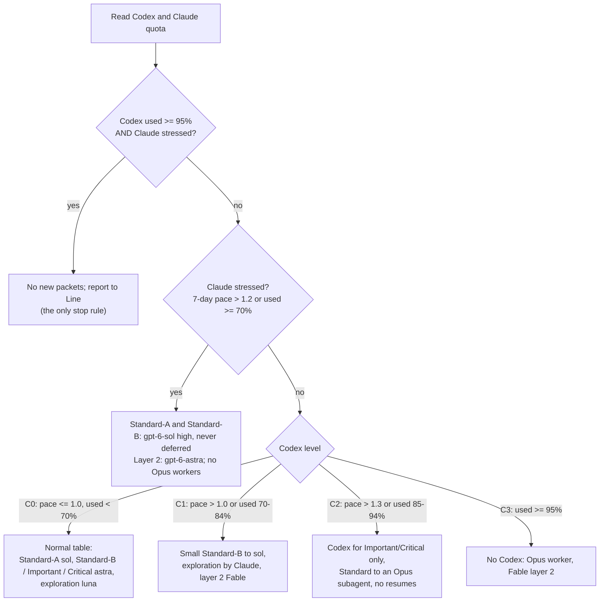
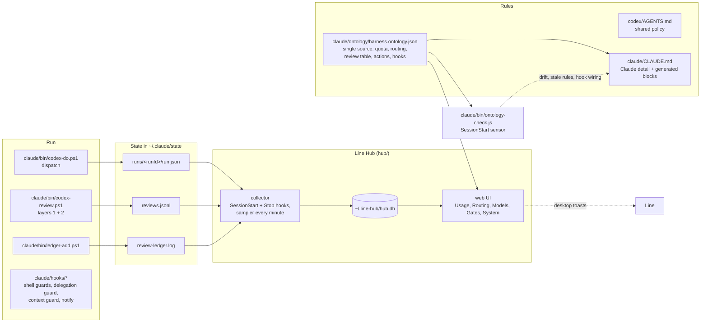

# Line Harness

Line's agent-coding setup on Windows 11: Claude Code as the supervisor, the Codex CLI as the worker, plus the hooks, skills, status line, and terminal configuration that hold them together.

This repository is a working backup of a real machine. You can read it to learn the setup, or restore it on a new machine with `restore.ps1`.

## How it works

| Role | Who | Job |
| --- | --- | --- |
| Owner | Line | Decides; approves Critical work; the only one who commits, pushes, or deploys |
| Supervisor | Claude Code, Opus 5.5 | Plans, writes the task packet, picks the model, verifies (layer 3), installs, reports |
| Worker | Codex CLI: `gpt-6-sol` (small), `gpt-6-astra` (large, Important, Critical), `gpt-6-luna` (exploration) | Implements the packet in a sandbox, writes only inside the repo it was given |
| Backup worker | Claude Opus subagent | Takes Standard work when Codex quota is tight |
| Reviewers | Fable 5.2 subagent, `gpt-6-astra` in a fresh session | Read the packet before dispatch; review the diff after; never the author |

### One task, end to end



### Routing by quota

Pace = used % / % of the window elapsed. The values live in `claude/ontology/harness.ontology.json`.



Low free RAM never blocks, waits, or stops a session. The RAM check only reports commit headroom.

### Components and data flow



`ontology-check.js` runs at every session start. It prints only when something is wrong: a generated CLAUDE.md block that was edited by hand, a hook that is not wired as the ontology says, a repo file that differs from the installed one, or a stale rule value in memory or docs. To change a rule, edit the ontology, then run `node ~/.claude/bin/ontology-check.js --write`.

The full operating policy is in `codex/AGENTS.md` (shared rules) and `claude/CLAUDE.md` (Claude-side detail).

## Layout

| Path | Restores to | Contents |
| --- | --- | --- |
| `claude/CLAUDE.md`, `claude/settings.json` | `~/.claude/` | Claude Code rules and settings (hooks, model, status line) |
| `claude/bin/` | `~/.claude/bin/` | Worker dispatch (`codex-do.ps1`), review gate (`codex-review.ps1`), ledger (`ledger-add.ps1`), packet lint, ontology sensor (`ontology-check.js`), Codex account switcher, sandbox preflight, run notifications, weekly MCP updater, self-tests |
| `claude/hooks/` | `~/.claude/hooks/` | PreToolUse, UserPromptSubmit, PostToolUse, Stop, and SessionStart hooks |
| `claude/docs/` | `~/.claude/docs/` | Harness reference, packet checklist, workflow notes |
| `claude/ontology/` | `~/.claude/ontology/` | `harness.ontology.json`: the single source of quota, routing, review, action, and hook rules |
| `claude/statusline-ultrathink.js` | `~/.claude/` | UltraThink status line: model, context, quotas, worker runs |
| `claude/commands/`, `claude/skills/` | `~/.claude/` | Slash commands and the installed skill bank |
| `claude/memory/` | `~/.claude/projects/<project>/memory/` | Persistent memory notes (reference only, machine-specific) |
| `claude/mcp-servers.json` | `mcpServers` in `~/.claude.json` | MCP server definitions (tokens removed) |
| `claude/plugins/` | `~/.claude/plugins/` | Installed plugin and marketplace lists |
| `codex/AGENTS.md`, `codex/config.toml`, `codex/hooks.json` | `~/.codex/` | Codex rules, configuration, and hooks |
| `codex/hooks/`, `codex/rules/`, `codex/skills/`, `codex/skills-archive/` | `~/.codex/` | Codex hooks, rules, active and archived skills |
| `hub/` | runs in place | Line Hub: local dashboard (collector, server, web UI, tests). Start with `npm run hub` in `hub/` |
| `terminal/windows-terminal-settings.json` | Windows Terminal `LocalState/settings.json` | Windows Terminal profiles and theme |
| `scheduled-tasks/*.xml` | Task Scheduler | Weekly MCP update and Docker RAM tracker (headless through `conhost.exe --headless`) |

## Restore on a new machine

Requirements: Windows 11, PowerShell 5.1, Node.js, Git, the Claude Code CLI, and the Codex CLI.

```powershell
git clone https://github.com/LineLuLan/line-harness.git
cd line-harness
powershell -NoProfile -ExecutionPolicy Bypass -File .\restore.ps1          # dry run: shows what would be copied
powershell -NoProfile -ExecutionPolicy Bypass -File .\restore.ps1 -Apply   # copies files, backs up existing ones first
```

`restore.ps1` also merges the four Claude MCP servers (context7, github, neon, langfuse; codegraph was removed on 2026-11-15) into `~/.claude.json` through `claude/merge-mcp.js`. It adds only servers that are missing, keeps everything else in the file, and saves a backup first. Codex MCP servers come with `codex/config.toml`.

Do these steps by hand:

1. Set the `GITHUB_PAT_TOKEN` environment variable. The GitHub MCP header uses `Bearer ${GITHUB_PAT_TOKEN}`; Claude Code documents `${VAR}` expansion for `.mcp.json`. If the server does not authenticate from `~/.claude.json`, put your token in that header directly.
2. Neon signs in through OAuth on first use. Langfuse reads `LANGFUSE_*` keys from `D:\01_Workspaces\TwoHearts\.env.local` (see `claude/bin/langfuse-mcp-launch.ps1`); change that path if your keys are elsewhere.
3. Sign in: `claude` and `codex login`.
4. Plugins: `settings.json` enables `codex@openai-codex` and `eli5@claude-community` and lists their marketplaces. If Claude Code does not install them on first start, run `/plugin install codex@openai-codex` and `/plugin install eli5@claude-community`. Codex plugin packages are not in this repository; Codex downloads them from its marketplaces.
5. Import a scheduled task: `Register-ScheduledTask -Xml (Get-Content .\scheduled-tasks\MCP-Weekly-Update.xml -Raw) -TaskName MCP-Weekly-Update`.

The configs were captured on a machine whose user folder is `C:\Users\ADMIN`. With `-Apply`, `restore.ps1` rewrites that folder to your own user folder in `~/.claude/settings.json` (hooks and status line), `~/.codex/config.toml`, and `~/.codex/hooks.json`. The rule files (`CLAUDE.md`, `AGENTS.md`) still mention `C:\Users\ADMIN` as text.

The status line's OpenRouter row reads the `OPENROUTER_API_KEY` environment variable. Without it, the row stays empty; the other rows still work.

## What is not in this repository

Credentials (`auth.json`, `.credentials.json`, `.env`), API tokens, conversation transcripts, session logs, and caches. All files were scanned for secrets before publication. The one live token found (a GitHub token in an MCP header) was replaced with `${GITHUB_PAT_TOKEN}`.

## License

MIT. See `LICENSE`.
