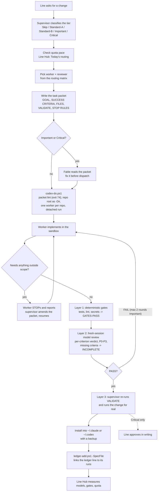
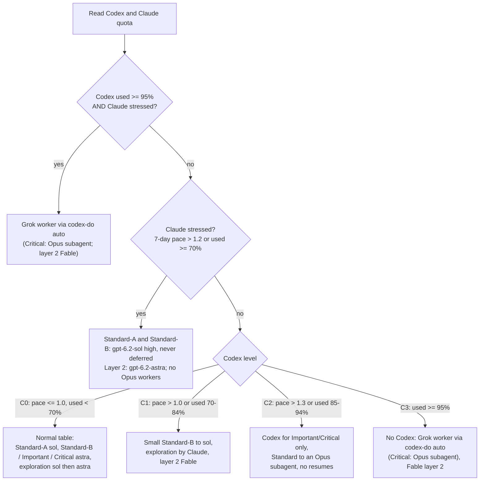
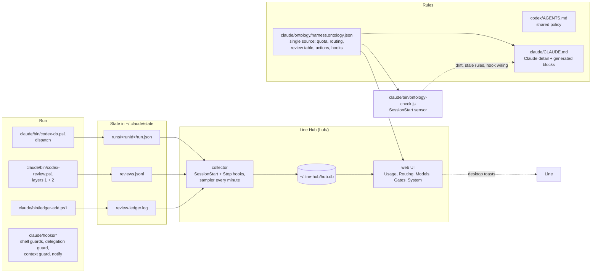

# Line Harness

Line's agent-coding setup on Windows 11: Claude Code as the supervisor, the Codex CLI as the worker, plus the hooks, skills, status line, and terminal configuration that hold them together.

This repository is a working backup of a real machine. You can read it to learn the setup, or restore it on a new machine with `restore.ps1`.

## How it works

| Role | Who | Job |
| --- | --- | --- |
| Owner | Line | Decides; approves Critical work; the only one who commits, pushes, or deploys |
| Supervisor | Claude Code, Opus 5.5 | Plans, writes the task packet, picks the model, verifies (layer 3), installs, reports |
| Worker | Codex CLI: `gpt-6.2-sol` (small), `gpt-6.2-astra` (large, Important, Critical), `gpt-6.2-sol` then `gpt-6.2-astra` (exploration) | Implements the packet in a sandbox, writes only inside the repo it was given |
| Backup worker | Claude Opus subagent | Takes Standard work when Codex quota is tight |
| Reviewers | Fable 5.2 subagent, `gpt-6.2-astra` in a fresh session | Read the packet before dispatch; review the diff after; never the author |

### One task, end to end



### Routing by quota

Pace = used % / % of the window elapsed. The values live in `claude/ontology/harness.ontology.json`.



Low free RAM never blocks, waits, or stops a session. The RAM check only reports commit headroom.

### Components and data flow



`ontology-check.js` runs at every session start. It prints only when something is wrong: a generated CLAUDE.md block that was edited by hand, a hook that is not wired as the ontology says, a repo file that differs from the installed one, or a stale rule value in memory or docs. To change a rule, edit the ontology, then run `node ~/.claude/bin/ontology-check.js --write`.

The full operating policy is in `codex/AGENTS.md` (shared rules) and `claude/CLAUDE.md` (Claude-side detail).

## Workers, engines and accounts

### Engine swap: Codex or Grok

`codex-do.ps1` runs every packet on one of two engines. `-Engine` defaults to `auto`:

- **auto**: Codex while it has quota. When the active Codex account's weekly quota is used >= 95% (fresh data), the run goes to the Grok Build CLI. Critical packets never auto-switch (their worker is an Opus subagent).
- **Precedence**: `-Engine codex|grok` flag > env `CODEX_DO_ENGINE` > `~/.claude/state/engine.txt` (set with `-SetEngine`) > auto.
- **Grok runs** use `grok-4.7-build-fast` at effort `xhigh` with `--no-plan --disable-web-search --no-subagents --max-turns 300` and a system-prompt rule to finish every criterion. Grok works in an isolated worktree that is a byte-exact copy of the repo (hash manifest). Its result comes back file by file only if nothing changed in the repo meanwhile (else exit 77, nothing applied), and every applied run can be reverted with `-Undo`. MCP tools are blocked on every Grok run. Grok's own sandbox is not enforced on Windows, so isolation comes from the worktree, git deny rules and tool lists.
- **On Grok**, `-Resume` continues a Grok session, `-Sandbox read-only` brings nothing back, `-Attached` waits and `-Account` is ignored.
- **Review**: `codex-review.ps1` takes the same `-Engine auto|codex|grok`; when Codex is out, the layer-2 model review runs on Grok (read-only tool list), next to the Fable subagent review.

```powershell
codex-do.ps1 -SetEngine show                 # current engine, its source, Codex used %
codex-do.ps1 -SetEngine grok                 # force Grok   (codex | auto to change back)
codex-do.ps1 -Dir <repo> -SpecFile p.md      # dispatch on the chosen engine
codex-do.ps1 -Status                         # list runs;  -Attach last  /  -Cancel last
codex-do.ps1 -Undo last -Dir <repo>          # revert the newest applied Grok run byte-exact
```

The status line's codex row shows the engine (`engine: grok (auto)`); the grok row shows the Grok weekly quota.

### Codex accounts (`codex-acc.ps1`, in this repository)

Each account has its own Codex home under `~/.codex-accounts/<name>`, so switching never copies or rewrites tokens. `codex-do.ps1 -Account <name>` runs one packet on another account without changing the default.

```powershell
codex-acc.ps1 list                 # accounts, weekly used %, reset, logged in
codex-acc.ps1 add <name>           # new home + browser login (names: lowercase; main/acc1/acc2 are reserved)
codex-acc.ps1 login <name>         # log in again
codex-acc.ps1 use <name>           # switch the default account
codex-acc.ps1 run -Account <name>  # start Codex on one account
```

Log each ChatGPT account into one name only; two homes with the same login rotate each other's token out.

### Claude accounts (optional external tool)

Claude Code account switching uses [realiti4/claude-swap](https://github.com/realiti4/claude-swap) (MIT, not included here). It was reviewed before use (static review 2026-11-18: only Anthropic hosts and a PyPI update check). Install it pinned: `uv tool install claude-swap==1.1.0`, then `cswap config set updates.check false`.

```text
/login (Claude Code)  then  cswap add     # store an account (never /logout first)
cswap list                                # every account's 5h / 7d usage
cswap switch [n | email | --strategy best]
cswap run <n>                             # one terminal on another account, others unchanged
```

On Windows it keeps tokens base64-encoded in `~/.claude-swap-backup/`; treat that folder as a secret store. A switch moves every running Claude Code session to the new account on its next message. The status line notices a switch at once (caches older than `~/.claude/.credentials.json` are refreshed).

## Layout

| Path | Restores to | Contents |
| --- | --- | --- |
| `claude/CLAUDE.md`, `claude/settings.json` | `~/.claude/` | Claude Code rules and settings (hooks, model, status line) |
| `claude/bin/` | `~/.claude/bin/` | Worker dispatch (`codex-do.ps1`, Grok engine `grok-engine-lib.ps1` + `grok-bringback.ps1`), review gate (`codex-review.ps1`), ledger (`ledger-add.ps1`), packet lint, ontology sensor (`ontology-check.js`), Codex account switcher, sandbox preflight, run notifications, weekly MCP updater, self-tests |
| `claude/hooks/` | `~/.claude/hooks/` | PreToolUse, UserPromptSubmit, PostToolUse, Stop, and SessionStart hooks |
| `claude/docs/` | `~/.claude/docs/` | Harness reference, packet checklist, workflow notes |
| `claude/ontology/` | `~/.claude/ontology/` | `harness.ontology.json`: the single source of quota, routing, review, action, and hook rules |
| `claude/statusline-ultrathink.js` | `~/.claude/` | UltraThink status line: model, context, quotas, worker runs |
| `claude/commands/`, `claude/skills/` | `~/.claude/` | Slash commands and the installed skill bank |
| `claude/memory/` | `~/.claude/projects/<project>/memory/` | Persistent memory notes (reference only, machine-specific) |
| `claude/mcp-servers.json` | `mcpServers` in `~/.claude.json` | MCP server definitions (tokens removed) |
| `claude/plugins/` | `~/.claude/plugins/` | Installed plugin and marketplace lists |
| `codex/AGENTS.md`, `codex/config.toml`, `codex/hooks.json` | `~/.codex/` | Codex rules, configuration, and hooks |
| `codex/rules/`, `codex/skills/`, `codex/skills-archive/` | `~/.codex/` | Codex rules, active and archived skills |
| `hub/` | runs in place | Line Hub: local dashboard (collector, server, web UI, tests). Start with `npm run hub` in `hub/` |
| `terminal/windows-terminal-settings.json` | Windows Terminal `LocalState/settings.json` | Windows Terminal profiles and theme |
| `scheduled-tasks/*.xml` | Task Scheduler | Weekly MCP update and Docker RAM tracker (headless through `conhost.exe --headless`) |

## Restore on a new machine

Requirements: Windows 11, PowerShell 5.1, Node.js, Git, the Claude Code CLI, and the Codex CLI. Optional: the Grok Build CLI (`~/.grok/bin/grok.exe`, sign in with `grok login`) for the Grok engine, and `uv` for claude-swap.

```powershell
git clone https://github.com/LineLuLan/line-harness.git
cd line-harness
powershell -NoProfile -ExecutionPolicy Bypass -File .\restore.ps1          # dry run: shows what would be copied
powershell -NoProfile -ExecutionPolicy Bypass -File .\restore.ps1 -Apply   # copies files, backs up existing ones first
```

`restore.ps1` also merges the four Claude MCP servers (context7, github, neon, langfuse; codegraph was removed on 2026-11-15) into `~/.claude.json` through `claude/merge-mcp.js`. It adds only servers that are missing, keeps everything else in the file, and saves a backup first. Codex MCP servers come with `codex/config.toml`.

Do these steps by hand:

1. Set the `GITHUB_PAT_TOKEN` environment variable. The GitHub MCP header uses `Bearer ${GITHUB_PAT_TOKEN}`; Claude Code documents `${VAR}` expansion for `.mcp.json`. If the server does not authenticate from `~/.claude.json`, put your token in that header directly.
2. Neon signs in through OAuth on first use. Langfuse reads `LANGFUSE_*` keys from `D:\01_Workspaces\TwoHearts\.env.local` (see `claude/bin/langfuse-mcp-launch.ps1`); change that path if your keys are elsewhere.
3. Sign in: `claude` and `codex login`.
4. Plugins: `settings.json` enables `codex@openai-codex` and `eli5@claude-community` and lists their marketplaces. If Claude Code does not install them on first start, run `/plugin install codex@openai-codex` and `/plugin install eli5@claude-community`. Codex plugin packages are not in this repository; Codex downloads them from its marketplaces.
5. Import a scheduled task: `Register-ScheduledTask -Xml (Get-Content .\scheduled-tasks\MCP-Weekly-Update.xml -Raw) -TaskName MCP-Weekly-Update`.

The configs were captured on a machine whose user folder is `C:\Users\ADMIN`. With `-Apply`, `restore.ps1` rewrites that folder to your own user folder in `~/.claude/settings.json` (hooks and status line), `~/.codex/config.toml`, and `~/.codex/hooks.json`. The rule files (`CLAUDE.md`, `AGENTS.md`) still mention `C:\Users\ADMIN` as text.

The status line's Grok row reads `~/.grok/auth.json` (Grok CLI login) and shows the weekly quota; without a login it shows "not logged in".

## What is not in this repository

Credentials (`auth.json`, `.credentials.json`, `.env`), API tokens, conversation transcripts, session logs, and caches. All files were scanned for secrets before publication. The one live token found (a GitHub token in an MCP header) was replaced with `${GITHUB_PAT_TOKEN}`.

## Credits

Some parts come from other projects. Each keeps its own licence; the MIT licence of this repository does not replace it. Licences were checked on GitHub on 2026-11-15.

| Part in this repository | Source | Licence |
| --- | --- | --- |
| `claude/statusline-ultrathink.js` (redesigned) | [InugamiDev/ultrathink-oss](https://github.com/InugamiDev/ultrathink-oss) statusline | MIT |
| `impeccable-*` skills (adapted) | [pbakaus/impeccable](https://github.com/pbakaus/impeccable) | Apache-2.0 (the copies are modified) |
| `gsd-*` skills (adapted) | [gsd-build/get-shit-done](https://github.com/gsd-build/get-shit-done) | MIT |
| `ui-ux-pro-max` skill (adapted edition) | [nextlevelbuilder/ui-ux-pro-max-skill](https://github.com/nextlevelbuilder/ui-ux-pro-max-skill) | MIT |
| `vercel-react-native-skills` | [vercel-labs/agent-skills](https://github.com/vercel-labs/agent-skills) | MIT (stated in its SKILL.md) |
| `codex/skills/.system/*` | Bundled with the OpenAI Codex CLI | Apache-2.0 (licence file in each folder) |
| `codex/skills-archive/compliance-checker` | Affitor | MIT (licence file in the folder) |
| `twohearts-*` skills | Twohearts-Technologies/SKILLs-repository (team bank) | Published with the team's knowledge; ask the team before reuse |
| `vc-*` skills | Source not recorded | Ask before reuse |

Account-synced Claude skills (`claude/skills/synced/`) are not published.

## License

MIT for the original parts. See `LICENSE` and the Credits table above.
